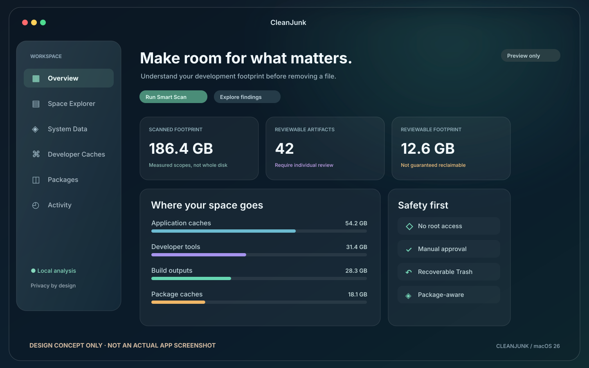
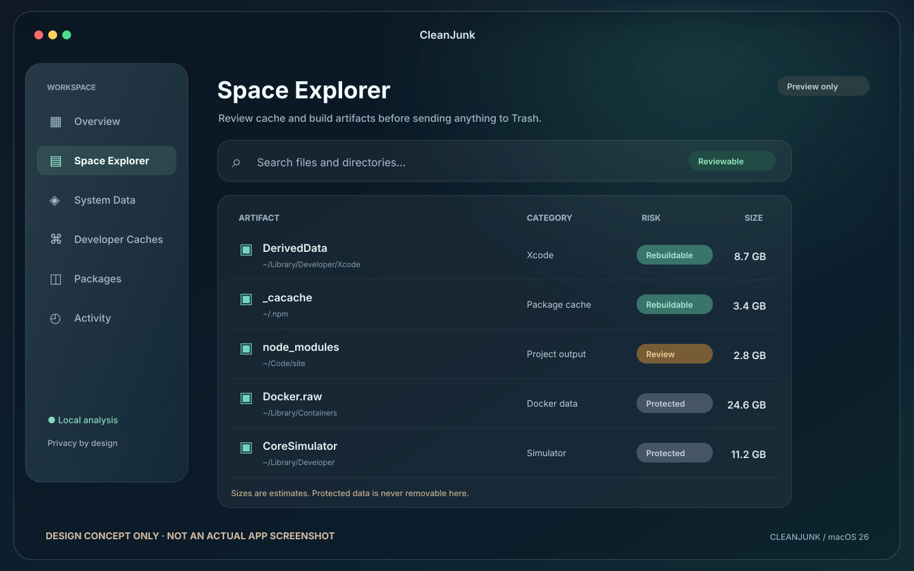
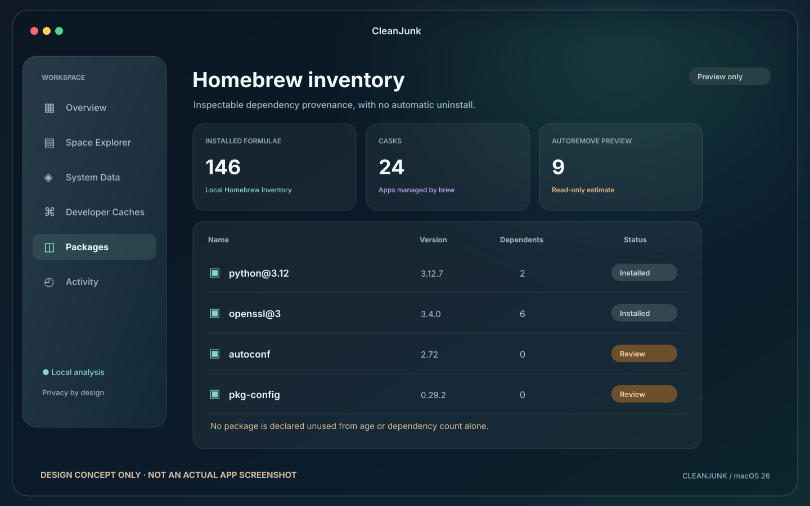
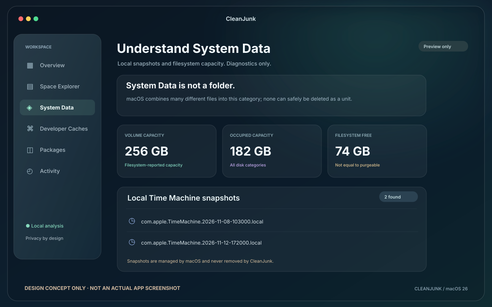

# CleanJunk

**Native macOS storage intelligence for developers. Understand what occupies your disk before removing it.**

CleanJunk inspects developer caches, build artifacts, selected workspaces, package metadata, SDKs and local storage diagnostics. It is written in **SwiftUI + AppKit**, with native **Liquid Glass** components on macOS 26.

**Current status: 0.10.0 full-disk intelligence development candidate, not a verified public release.** The current branch has not yet completed its final macOS build, physical-device validation, or Apple notarization. Use disposable test data.

**Documentation:** English (this page) · [فارسی](docs/README.fa.md)

---

## Interface gallery

| Overview | Space Explorer |
|:--:|:--:|
|  |  |
| Packages | System Data |
|  |  |

**Image authenticity:** These four images are **illustrative UI concepts, not actual screenshots from a running app**. Each image is labeled. A real macOS screenshot requires running the app and capturing its window. The repository includes a [real screenshot capture script](scripts/capture-screenshots.sh) and [instructions](docs/screenshots/README.md); actual images will be used only after capture and privacy review.

## Contents

- [Features](#features)
- [Requirements](#requirements)
- [Install without an Apple Developer account](#install-without-an-apple-developer-account)
- [Build locally](#build-locally)
- [How to use](#how-to-use)
- [Cleanup safety and recovery](#cleanup-safety-and-recovery)
- [Project structure](#project-structure)
- [Tests and CI](#tests-and-ci)
- [Troubleshooting](#troubleshooting)
- [Contributing and license](#contributing-and-license)

## Full Mac Intelligence — new deep inventory

The **Full Mac Scan** sidebar page can attempt a read-only, file-by-file inventory of the current Mac, including hidden files, application bundles, app containers and package installations. It stores file metadata in a paged **SQLite index**, supports searching by path or app ownership, shows evidence-based protection advice, and exports a complete CSV report. It also reads system installer receipts (pkgutil) and continues to support Homebrew separately.

**Not every macOS file is accessible.** Full Disk Access may help with protected user data, but SIP, private app containers, mounted volumes and APFS snapshots remain subject to OS restrictions. The app records inaccessible paths instead of pretending coverage is complete. This index never authorizes automatic deletion. Only the existing approved-cache cleanup path can move explicitly selected items to Trash.

[Read the complete deep storage design, privacy model and limits](docs/DEEP_STORAGE.md).

## Features

| Feature | Implemented behavior | Important limit |
|---|---|---|
| Full Mac Intelligence | Comprehensive read-only file-by-file metadata indexing, evidence-based risk classification, SQLite search, CSV export, pkgutil receipts | Protected and inaccessible locations are reported; no automatic file deletion |
| Overview | Scan summary, measured footprints, risk classification, incomplete-scan warnings | Does not report all macOS System Data |
| Space Explorer | Browse, filter and search cache artifacts, reveal in Finder, select exact items | Partial and protected items cannot be removed |
| Developer workspace | User-selected folder; detects generated directories such as node_modules, .next, .venv, target and .gradle | Never considers project source code a cleanup artifact |
| Dependency manifests | Finds Node.js, Python, Rust and Go projects; analyzes package.json and npm lockfile metadata | Full Python/Rust/Go dependency resolution is not available |
| Import evidence | Optional bounded scan of JS/TS import and require references | Missing static references do NOT prove a package is unused |
| Homebrew | Local installed formula/cask inventory, reverse dependencies and autoremove dry run | Read-only: no brew uninstall is executed |
| SDK / simulator | Shows select Android SDK, iOS and Android emulator footprints | Protected and inspection-only |
| Docker | Shows detected Docker VM disk file sizes | Never deletes Docker.raw directly |
| System Data | Volume capacity and local Time Machine snapshot identifiers | Read-only diagnostics, not System Data cleanup |
| Cleanup | Manual selection + confirmation, audited move into user Trash | No permanent delete, unattended sweep or cross-volume copy |
| History and Restore | Durable operation journal, unresolved-operation detection, guarded Restore | Restore may be rejected for missing/changed files and occupied original paths |

### What it does not do

CleanJunk is not a generic one-click junk remover, a package uninstaller, an APFS snapshot deletion tool, or a promise that the displayed footprint is reclaimable. APFS clones, shared file blocks, hard links, backups and purgeable data can all affect actual free space.

## Requirements

| Item | Requirement |
|---|---|
| macOS | **26 or newer** — required by native Liquid Glass APIs |
| Architecture | The GitHub preview workflow targets **Apple Silicon / arm64** |
| Local developer tools | **Xcode 26 and Swift 6.2** with macOS 26 SDK |
| Paid Apple Developer account | **Not necessary** for local or GitHub-built ad-hoc developer previews |
| Notarized release | Requires Developer ID Application certificate and Apple notarization |
| GitHub | The repository is currently **private**; users need owner-granted repository access |

The project uses native SwiftUI, AppKit and Foundation rather than Electron or a web runtime. There is no required backend account or analytics server.

## Install without an Apple Developer account

There are **two supported developer-build routes**. An ad-hoc signature is suitable for personal testing, but it is not a notarized public distribution signature. macOS Gatekeeper can block downloads until the user explicitly reviews and approves them.

### A. Build through GitHub Actions — no local Xcode

**This workflow is manual-only. Pushes and Pull Requests use zero GitHub Actions runner minutes.**

1. Open the [repository Actions page](https://github.com/SaeedTqpy/CleanJunk/actions).
2. Select the manual macOS 26 build workflow.
3. Choose **Run workflow**, select a reviewed branch (currently **feat/dependency-intelligence-and-scan-v2**) and set **publish_preview=true** if you actually need an installable ZIP.
4. The **single** macOS job runs Swift tests, builds the app, creates a Retina icon, packages an ad-hoc-signed ZIP and verifies its checksum. If the build or tests fail, no preview is published.
5. Open [Releases](https://github.com/SaeedTqpy/CleanJunk/releases), find the prerelease matching the built commit, and download the ZIP plus its SHA-256 file. **A tag without assets is not an app download.**
6. Verify the files in Terminal:

~~~bash
cd ~/Downloads
shasum -a 256 -c CleanJunk-macos26-arm64.zip.sha256
~~~

7. Extract the ZIP, move **CleanJunk.app** to **Applications**, and try to open it.

**Gatekeeper:** Ad-hoc builds are not verified by Apple's Developer ID/notarization process. Only if you trust and have verified the specific build, Apple explains how to grant an individual exception at **System Settings → Privacy & Security → Open Anyway**, after an attempted launch. **Do not disable Gatekeeper globally or follow scripts that remove all quarantine attributes.** Read [Apple's official security guidance](https://support.apple.com/en-us/102445).

**No Developer account is needed for this path.** A properly notarized, friction-free external distribution is a different release track and cannot be promised without an Apple Developer membership.

### B. Compile from source on a Mac

With Xcode 26 installed and macOS 26 running:

~~~bash
git clone https://github.com/SaeedTqpy/CleanJunk.git
cd CleanJunk
git switch feat/dependency-intelligence-and-scan-v2

swift test --parallel
bash scripts/package-app.sh release
open dist/CleanJunk.app
~~~

The package script writes the application, ZIP and portable SHA-256 file to **dist/**. The generated icon is original and created from source in **scripts/generate-icon.swift**.

For a lightweight local core type-check (no CI usage):

~~~bash
bash scripts/check-core.sh
~~~

## How to use

1. **Overview:** On launch, review the read-only scan summary, warnings and measured disk footprints.
2. **Space Explorer:** Search or filter artifacts, inspect the paths, and reveal uncertain items in Finder. Protected items and incomplete scan measurements must not be cleaned.
3. **Developer Caches:** Select a specific workspace folder. Review generated directories and discovered Node/Python/Rust/Go projects. For Node projects, the **Analyze imports** action shows static import evidence; it never authorizes an uninstall.
4. **Packages:** Review local Homebrew inventory and its **autoremove dry-run**. No installed formula is removed here.
5. **System Data:** Inspect capacity and Time Machine snapshot identifiers. This is diagnostic and read-only.
6. **Review cleanup:** Approve the exact selected artifacts. They are moved to your user Trash, not erased.
7. **Activity:** Review the durable journal, restore a matching Trash item when possible, and investigate unfinished operations instead of assuming success.

**Test with disposable caches first.** Even a rebuildable cache can be expensive to regenerate or essential to current work when offline.

## Cleanup safety and recovery

- **No automatic cleanup:** Every mutation is explicit, with user confirmation.
- **Allowed roots only:** Candidates must come from known scan policies or a selected development workspace.
- **Protected data:** Docker VM disks, SDK and simulator installations, Xcode archives and Time Machine snapshots cannot be directly removed.
- **Fail-closed scanning:** Missing file identities, changed inodes, symbolic links and incomplete scans stop cleanup.
- **No overwrite:** On supported local volumes, directory-descriptor-relative same-volume operations refuse existing destinations.
- **Write-ahead journal:** The operation is recorded before moving the file. Interrupted or ambiguous moves remain unresolved for investigation.
- **Restore:** Matching files can be restored from Trash only when the original location is available and the recorded identity still matches. Finder's native **Put Back** metadata may not exist for these moves.
- **Space is an estimate:** Trash must be emptied separately to reclaim space. APFS shared allocation means reported bytes cannot guarantee savings.
- **Residual race:** A hostile process able to modify the source directory can race the final inode check because the OS does not offer an atomic compare-identity-and-rename primitive. CleanJunk is for manually approved cleanup of trusted local workspaces, not a hostile multiuser environment.

Read the full [security model](docs/SECURITY_MODEL.md) and [mandatory release checklist](docs/RELEASE_CHECKLIST.md).

## Project structure

~~~text
CleanJunk/
├── Sources/CleanJunkApp/          Native macOS pages and application state
├── Sources/CleanJunkCore/         Scanners, dependency evidence, safety policies, Trash and journal
├── Tests/CleanJunkCoreTests/      Regression and safety tests
├── scripts/
│   ├── check-core.sh             Local type-check
│   ├── generate-icon.swift       Retina icon generator
│   ├── package-app.sh            .app, .icns, ZIP, SHA-256
│   └── capture-screenshots.sh    Real window capture, user controlled
├── docs/
│   ├── previews/                 Labeled design concepts (SVG)
│   ├── screenshots/              Real screenshot instructions and future PNG captures
│   ├── PRIVACY.md
│   ├── SECURITY_MODEL.md
│   └── RELEASE_CHECKLIST.md
└── .github/workflows/
    ├── macos.yml                 Manual-only build + optional developer preview
    └── release.yml               Manual-only Apple signing/notarization draft-release track
~~~

Architecture is local-first. The GUI depends on a separate Swift package core. Package manager inspection uses bounded subprocess execution and explicit argument arrays, without running shell strings from project metadata.

## Tests and CI

With the supported macOS toolchain:

~~~bash
swift test --parallel
bash scripts/check-core.sh
bash scripts/package-app.sh release
(cd dist && shasum -a 256 -c *.sha256)
codesign --verify --strict --verbose=2 dist/CleanJunk.app
plutil -lint dist/CleanJunk.app/Contents/Info.plist
~~~

**No automatic workflow runs.** For consolidated changes, run the manual macOS validation once. The separately configured **Manual Developer ID Release** workflow requires an Apple Developer Program account, signing secrets and notarization; it is **not** part of the no-account preview route.

Compilation is not a substitute for physical Mac testing, VoiceOver review or destructive-operation regression testing.

## Screenshots

The image gallery at the top is **concept artwork**, not genuine screenshots. To capture actual app windows without uploading anything:

~~~bash
# Run CleanJunk.app, navigate to a page and follow the prompts:
bash scripts/capture-screenshots.sh
~~~

This captures **overview.png**, **space-explorer.png**, **packages.png** and **system-data.png** in **docs/screenshots/**. The script is interactive and asks you to click the real app window each time. Inspect the PNGs to ensure private usernames, project paths and package lists are not disclosed before sharing.

See [the screenshot privacy and capture guide](docs/screenshots/README.md). There are **no verified real screenshots in this branch yet**; previews will be replaced when images from the running macOS app are available.

## Troubleshooting

| Symptom | Resolution |
|---|---|
| A preview ZIP is missing | A test-only manual run does not upload releases; use publish_preview=true when validation is ready |
| Cannot access GitHub repo | It is private. Ask the owner to grant access |
| App blocked by Gatekeeper | Verify SHA-256 and provenance; consult the Apple guidance above; do not disable platform-wide security |
| Swift/macOS SDK not found | Install Xcode 26 or use the manual GitHub workflow |
| Homebrew not found | Inspector expects /opt/homebrew/bin/brew or /usr/local/bin/brew |
| Scan measurements are partial | Review permission errors or scan limits; incomplete results are not eligible for removal |
| A package shows no imports | This does **not** mean it is unused; scripts/plugins/dynamic loading may reference it |
| Restore refused | Trash file may have changed, original path may be occupied, or the volume is unsupported; inspect Finder and Activity |
| No screenshots in README | The checked-in gallery is clearly marked concept-only; capture real windows with the included script |

When filing bugs, attach a reproducible procedure and macOS/app version, but **redact personal file paths and secrets**.

## Contributing and license

Read [CONTRIBUTING.md](CONTRIBUTING.md), [SECURITY.md](SECURITY.md) and [PRIVACY.md](docs/PRIVACY.md). The repository owner reviews changes to any destructive behavior, privacy-sensitive scanning or package adapter.

**License notice:** This repository **does not currently grant an open-source license**. Access to its source does not automatically authorize redistribution or derivative works. An explicit LICENSE file should be added by the owner before public open-source use. The repository is currently private.

---

**CleanJunk should explain a cleanup decision, not delete developer data on a guess.**
