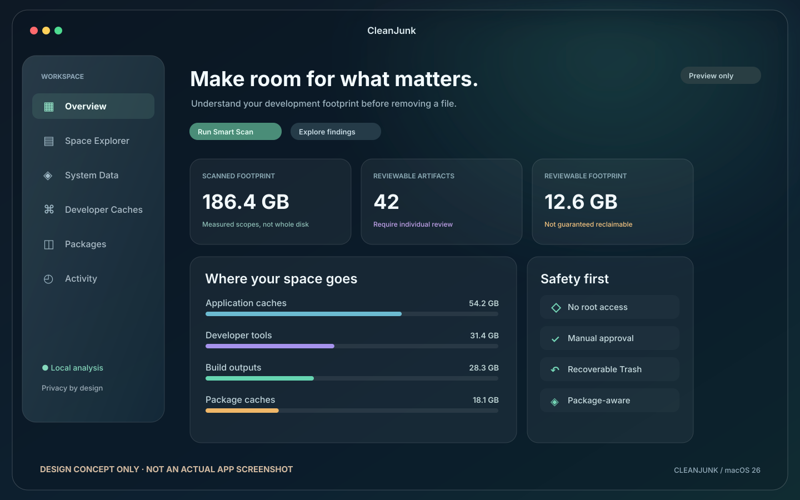

# راهنمای فارسی CleanJunk

**CleanJunk** ابزار بومی macOS برای بررسی فضای مصرفی توسعه‌دهندگان، تحلیل کش‌ها، پکیج‌ها و فایل‌های تولیدشده پروژه‌هاست. رابط آن با **SwiftUI + AppKit** و کنترل‌های واقعی **Liquid Glass** در macOS 26 نوشته شده است.

**وضعیت فعلی:** سورس نسخه ۰٫۹٫۰ کاندید انتشار است، اما Build نهایی آن روی macOS 26 و تست واقعی دستگاه هنوز تأیید نشده و نسخه عمومی Notarized وجود ندارد. پاک‌سازی را ابتدا فقط روی داده آزمایشی امتحان کنید.

[Full English README](../README.md)

## نمایش تصویری

این تصویر و سه تصویر دیگر پوشه previews **اسکرین‌شات واقعی نیستند**. برای عکس گرفتن از پنجره اجرای واقعی اپ، دستور زیر را در مک اجرا کنید:

~~~bash
bash scripts/capture-screenshots.sh
~~~

راهنمای کامل: [ثبت اسکرین‌شات واقعی](screenshots/README.md).

## نصب بدون حساب Apple Developer و بدون Xcode محلی

۱. وارد [Actions ریپازیتوری](https://github.com/SaeedTqpy/CleanJunk/actions) شوید.

۲. Workflow دستی ساخت macOS 26 را انتخاب کنید و **Run workflow** را بزنید.

۳. شاخه **feat/dependency-intelligence-and-scan-v2** را انتخاب کنید. فقط اگر فایل نصب می‌خواهید گزینه **publish_preview=true** را فعال کنید.

۴. پس از موفقیت تست‌ها، ZIP و فایل SHA-256 را از [Releases](https://github.com/SaeedTqpy/CleanJunk/releases) مربوط به همان Commit دریافت کنید.

۵. صحت فایل را بررسی کنید:

~~~bash
cd ~/Downloads
shasum -a 256 -c CleanJunk-macos26-arm64.zip.sha256
~~~

۶. ZIP را باز کنید و **CleanJunk.app** را در Applications قرار دهید.

**توجه امنیتی:** این Build امضای آزمایشی دارد و Apple Notarization ندارد. ممکن است macOS آن را مسدود کند. فقط در صورت اطمینان کامل به سورس و هش فایل، راهنمای رسمی Apple برای استثنای تکی در **System Settings → Privacy & Security → Open Anyway** را دنبال کنید. هرگز Gatekeeper را به‌صورت سراسری غیرفعال نکنید.

**GitHub Actions برای هر Commit اجرا نمی‌شود** و فقط با درخواست دستی فعال است. ریپو فعلاً خصوصی است و دریافت سورس و Releases به دسترسی GitHub نیاز دارد.

## ساخت محلی

پیش‌نیاز: macOS 26 و Xcode 26 / Swift 6.2.

~~~bash
git clone https://github.com/SaeedTqpy/CleanJunk.git
cd CleanJunk
git switch feat/dependency-intelligence-and-scan-v2
swift test --parallel
bash scripts/package-app.sh release
open dist/CleanJunk.app
~~~

## بخش‌های برنامه

- **Overview:** تحلیل خواندنی فضای فایل‌ها و میزان کامل بودن اسکن.
- **Space Explorer:** مشاهده، جستجو و انتخاب فایل‌های مجاز؛ حذف فقط با تأیید.
- **Developer Caches:** کش‌ها و خروجی‌های پروژه، شناسایی Node.js، Python، Rust و Go؛ تحلیل محدود importهای JS/TS.
- **Packages:** اطلاعات Homebrew و اجرای Dry Run؛ بدون حذف مستقیم پکیج.
- **System Data:** نمایش اطلاعات دیسک و Snapshotهای محلی، بدون حذف Snapshot.
- **Activity:** تاریخچه عملیات، وضعیت‌های نامشخص و امکان Restore ایمن در شرایط قابل قبول.

## قوانین مهم ایمنی

- هیچ حذف دائمی یا خودکاری انجام نمی‌شود؛ انتقال به Trash فقط با تأیید کاربر است.
- Docker.raw، اطلاعات دستگاه‌های شبیه‌ساز، SDKها و آرشیوهای Xcode محافظت‌شده‌اند.
- هر فایل باید از نظر مسیر، هویت و کامل‌بودن اسکن بررسی شود.
- اگر مقصد Restore اشغال باشد یا فایل عوض شده باشد، بازگردانی انجام نمی‌شود.
- **نبودن import در سورس به معنی بدون استفاده بودن پکیج نیست.**
- فضای نمایش‌داده‌شده به دلیل APFS و بلوک‌های مشترک، لزوماً برابر فضای آزادشده نیست.
- اجرای Cleanup روی داده‌های مهم باید بعد از تست کامل macOS 26 باشد.

مستندات: [امنیت](SECURITY_MODEL.md) · [حریم خصوصی](PRIVACY.md) · [چک‌لیست انتشار](RELEASE_CHECKLIST.md).

**مجوز استفاده:** این ریپو هنوز فایل LICENSE ندارد و انتشار عمومی/بازنشر کد نیازمند تعیین مجوز توسط مالک پروژه است.
